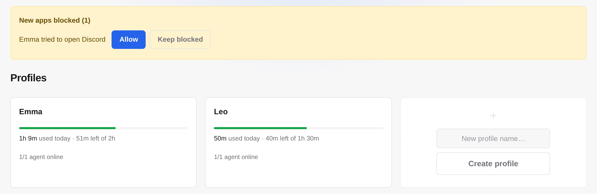
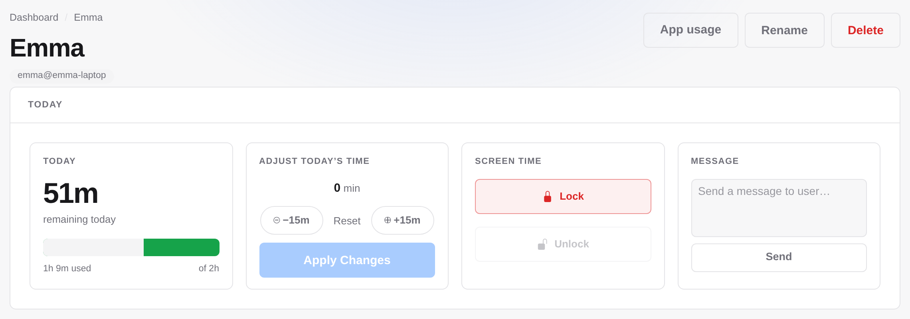
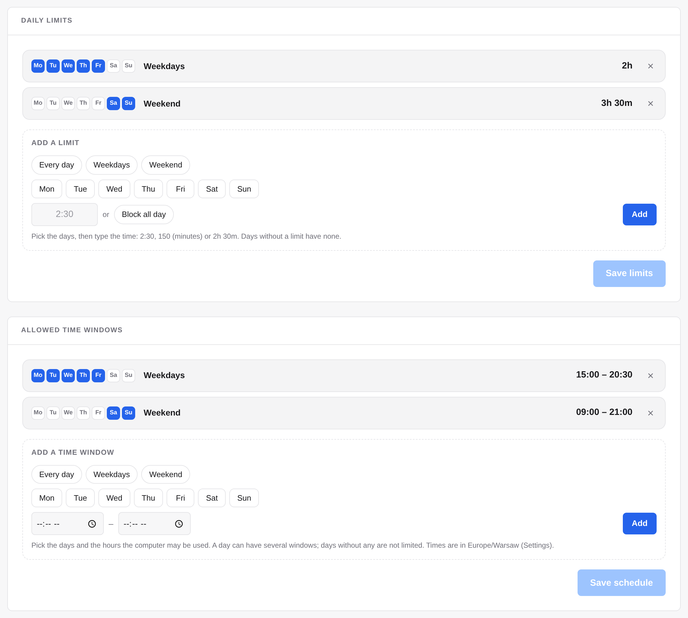
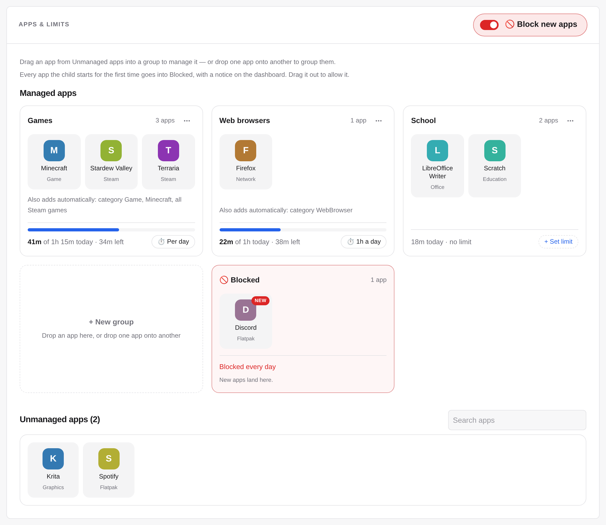
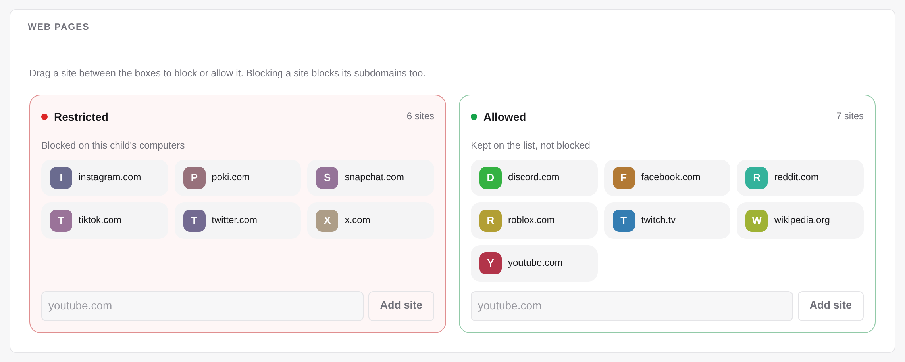
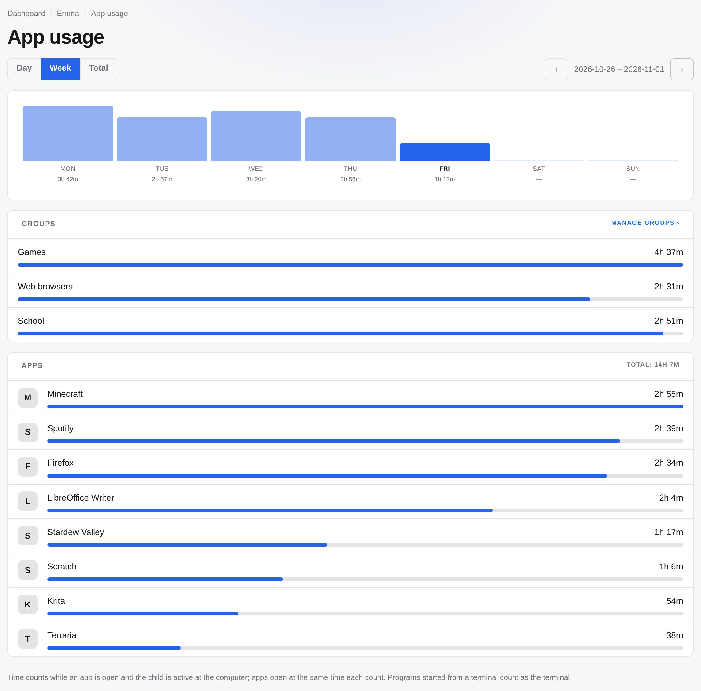
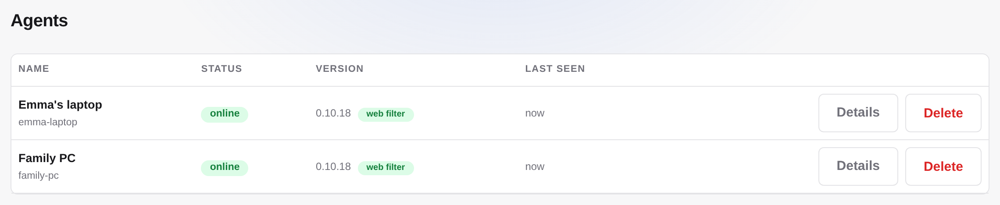

# ScreenGuard

Parental controls for Linux computers. Set how long and when each child may use the computer, which apps and games they can play and for how long, and which websites are off limits — from a web page on your own network or from your phone.

A small server keeps the rules; an agent on each child's computer enforces them, even while offline. Self-hosted, open source, with no data leaving your network unless you choose the hosted service.

> 📱 **Android app:** manage everything from your phone with **[screenguard-mobile](https://github.com/adambie/screenguard-mobile)** — [download the latest APK](https://github.com/adambie/screenguard-mobile/releases/latest).
>
> ☁️ **No server at home?** Use the hosted service at **[screenguard.cc](https://screenguard.cc)** — see [Cloud mode](docs/cloud.md).

<picture>
  <source media="(prefers-color-scheme: dark)" srcset="docs/screenshots/web-dashboard-dark.png">
  
</picture>

**Contents**

- **[Features](#features)** — [screen time](#screen-time-today) · [limits and time windows](#daily-limits-and-time-windows) · [apps and games](#apps-and-games) · [new apps](#blocking-new-apps) · [web pages](#web-pages) · [reports](#app-usage-reports)
- **[Getting started](#getting-started)** — [install the server](#1-install-the-server) · [install the agent](#2-install-the-agent-on-the-childs-computer) · [first setup](#3-set-up-in-the-web-ui)
- **[Architecture](#architecture)** and [more documentation](#more-documentation)

---

# Features

- **Daily screen time and allowed hours** per child, e.g. 2 hours on weekdays, between 15:00 and 20:30.
- **Hard enforcement** — when time is up, the child's desktop sessions are locked; optionally apps and unsaved work keep running behind the lock.
- **Warnings and messages** on the child's desktop before time runs out, in English, Polish, German, Spanish, French or Portuguese.
- **Extra time, lock now, send a message** — from the dashboard, the profile page or the phone.
- **Apps and games** — see which apps each child uses, group them, and give each group its own daily limit; ready-made *Games* and *Web browsers* groups fill themselves.
- **Block new apps** — an app the child starts for the first time stays blocked until you allow it.
- **Web pages** — block sites such as TikTok or Instagram on the child's computers.
- **Reports** — screen time per week, app time per day, week or in total, across all the child's computers.
- **Works offline** — the agent keeps enforcing the last rules it received.
- **Simple to run** — static binaries for x86_64 and aarch64, SQLite or Postgres, Docker images, mDNS so agents find the server by themselves.

## Screen time today

Each child has a profile. Its top shows the time left today, with buttons to add or take away time, lock the computer right away, or send a message to the child's desktop.

<picture>
  <source media="(prefers-color-scheme: dark)" srcset="docs/screenshots/web-profile-today-dark.png">
  
</picture>

## Daily limits and time windows

Set how much time a day the child gets and in which hours the computer may be used. Pick the days — every day, weekdays, weekend or any single days — and type the time as `2:30`, `150` or `2h 30m`, or block a day completely. Only what you set is listed; days without a limit or a window are not restricted. Click a row to change it.

<picture>
  <source media="(prefers-color-scheme: dark)" srcset="docs/screenshots/web-limits-windows-dark.png">
  
</picture>

When time is up, the child gets a warning and then the desktop is locked. By default the session is closed after a short grace period; with *keep tasks running* the apps stay open behind the lock until more time is granted. More in [How it works](docs/how-it-works.md#locking).

## Apps and games

**Apps & limits** shows every app the child has used as a tile. Drag an app into a group to manage it, drop one app onto another to start a new group, or drag it back to *Unmanaged apps*. Each group has its own daily limit — the same every day or per weekday — set right in its box, with a bar showing today's use and quick buttons for extra time.

Ready-made groups: **Games** (every app whose menu entry says it's a game, all Steam games, Minecraft), **Web browsers**, and **Blocked** for apps that are never allowed. Games and browsers installed later join their group automatically. When a group's time runs out, its apps are closed after a 10-second warning — only those apps, nothing else.

<picture>
  <source media="(prefers-color-scheme: dark)" srcset="docs/screenshots/web-apps-board-dark.png">
  
</picture>

## Blocking new apps

Switch on **Block new apps** and every app the child starts for the first time is closed and lands in **Blocked**. You get a notice on the dashboard — "*Emma tried to open Discord*" — with **Allow** and **Keep blocked**. To allow an app later, drag it out of Blocked. Apps installed system-wide already need an administrator password; this also catches what a child can add without one, such as Flatpak user installs, Steam games and downloaded programs.

## Web pages

Two boxes per child: **Restricted** sites are blocked on the child's computers, **Allowed** ones stay on the list without being blocked. Drag a site between them, or type or paste one into either box — `https://www.tiktok.com/@someone` becomes `tiktok.com`, and blocking a site blocks its subdomains too. Blocking happens on the computer itself; nothing about the child's browsing is reported.

<picture>
  <source media="(prefers-color-scheme: dark)" srcset="docs/screenshots/web-web-pages-dark.png">
  
</picture>

## App usage reports

Which apps each child used and for how long — per day, per week or in total, summed over all the child's computers, with time per group.

<picture>
  <source media="(prefers-color-scheme: dark)" srcset="docs/screenshots/web-app-usage-dark.png">
  
</picture>

App time counts while an app is open and the child is active at the computer. Only apps from the desktop menu are named — never window titles, files or web addresses. What exactly the agent reports is listed in [How it works](docs/how-it-works.md#what-the-agent-does-on-your-machine).

---

# Getting started

A basic home setup: the server and web UI on one always-on Linux machine (or one of the family computers), and the agent on each child's computer, all on the same network.

**Requirements**

- Linux with systemd, x86_64 or aarch64.
- Children's computers: a graphical desktop with logind (GNOME, KDE Plasma, Cinnamon, XFCE, Hyprland…); `nftables` for web page blocking.
- Server: any Linux with systemd, no desktop needed; Python 3 for the web UI. Or [Docker](docs/install.md#running-the-server-in-docker).

### 1. Install the server

```bash
curl -fsSL https://github.com/adambie/screenguard/releases/latest/download/install.sh | sudo bash
```

Choose **Server**, and answer **yes** to *Install web UI*. When it finishes it prints the web UI address — `http://<server-ip>:5000`. Open it and create the administrator account.

### 2. Install the agent on the child's computer

Run the same command on the child's computer and choose **Agent**, with **mDNS auto-discovery** to find the server (or enter its address). At the end the installer prints a **pairing code**; to show it again later run `sudo screenguard-agent --show-pairing-code`.

If the server and the child's computer are the same machine, choose **Both**.

### 3. Set up in the web UI

1. **Agents** — the new computer is listed as pending. Enter its pairing code and click **Accept**.

   <picture>
     <source media="(prefers-color-scheme: dark)" srcset="docs/screenshots/web-agents-dark.png">
     
   </picture>

2. **Dashboard** — create a profile for each child.
3. **Agents → Details** — assign the child's local account to their profile.
4. **Settings** — set your time zone (time windows use it).
5. On the profile, set daily limits, time windows, app groups and web pages.

Make sure the child's account is not an administrator (not in `wheel`/`sudo`) — the profile page warns if it is.

**Updating:** run the installer with `--update`, or use **Update** on the Agents page for agents. Docker, Postgres, firewall rules, configuration files and uninstalling are covered in [docs/install.md](docs/install.md).

---

# Architecture

```
  Your network                                     Child's computer
┌──────────────────────────────────┐            ┌─────────────────────────────┐
│  screenguard-server   REST + WS  │◄── WS ─────│  screenguard-agent   (root) │
│  (rules, usage, SQLite/Postgres) │            │  · counts screen & app time │
│                                  │            │  · locks the desktop        │
│  screenguard-webui    Flask      │            │  · closes over-limit apps   │
│  (the pages shown above)         │            │  · DNS proxy for web pages  │
└──────────────────────────────────┘            └─────────────────────────────┘
          ▲ REST
          │
     Android app
```

- **Server** (Rust, axum) — stores profiles, rules and usage, computes what each child has left, and pushes changes to the agents. SQLite by default, Postgres optional; announces itself over mDNS.
- **Agent** (Rust) — a systemd service on each child's computer. It always connects out to the server over a WebSocket (nothing connects to it), works with the desktop through logind and D-Bus, and keeps the last rules so it enforces them offline.
- **Web UI** (Python, Flask) and the **Android app** both talk to the server's REST API.
- The **hosted service** at screenguard.cc is the same server with multiple accounts; agents connect to it the same way.

The agent and the protocol are both in this repository: [what the agent sends and what a server can ask it to do](docs/how-it-works.md#what-the-agent-does-on-your-machine) is a short, complete list — no remote shell, no file access, no keystrokes or screenshots.

## More documentation

- [docs/install.md](docs/install.md) — installer options, Docker, Postgres, firewall, configuration, logs, re-pairing
- [docs/how-it-works.md](docs/how-it-works.md) — what the agent sends and accepts, locking, app recognition and limits, blocking new apps, web page blocking
- [docs/cloud.md](docs/cloud.md) — using the hosted service
- [screenguard-mobile](https://github.com/adambie/screenguard-mobile) — the Android app

## License

GPL-3.0 — see [LICENSE](LICENSE).
